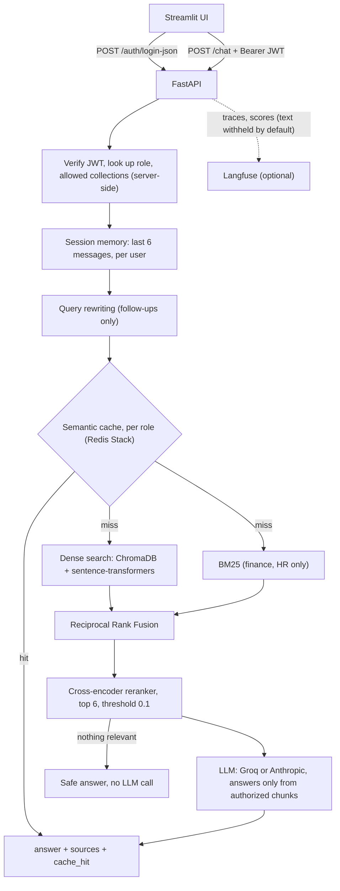
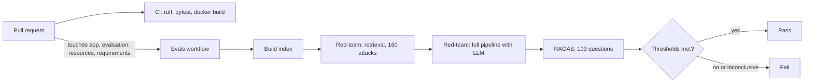

# FinSolve Technologies — Enterprise RAG Chatbot with Role-Based Access Control

An internal assistant that answers employees' questions from company documents (finance reports, HR records, marketing reports, engineering docs and the employee handbook) while guaranteeing that each person only sees data their role is entitled to.

**What problem it solves.** Company knowledge sits in many documents owned by different departments, and a generic chatbot over all of them would leak salaries, financials or HR records to anyone who asks. This project gives every employee one place to ask questions in plain language, with access control enforced on the server *before* any document is retrieved, and answers grounded only in authorized, relevance-checked content. When nothing relevant exists, the assistant says so instead of guessing.

**Who it helps.** Finance, marketing, HR and engineering staff (each gets their own department's documents), every other employee (the handbook) and executives (all departments), plus the security and platform teams who need evidence that access control actually holds.

**Verified at a glance:** 160-attack RBAC red-team with **0 leaks** · 103-question RAGAS evaluation with **faithfulness 0.977** · retrieval **Recall@5 1.000** · 841 automated tests · P50 latency about **0.9 s** (P95 2.4 s). Tests, the red-team and the RAGAS evaluation are gated in GitHub Actions.

## Contents

1. [Key features](#key-features)
2. [Architecture and workflow](#architecture-and-workflow)
3. [Tech stack and installation](#tech-stack-and-installation)
4. [Usage examples](#usage-examples)
5. [Evaluation, testing and limitations](#evaluation-testing-and-limitations)

---

## Key features

**Capabilities**

- **Role-based answers** — six roles, five department collections. The role comes from the signed JWT and selects the collections to search *before* retrieval, so unauthorized data never reaches the LLM and cannot leak through the prompt.
- **Hybrid retrieval** — dense vector search plus BM25 keyword search fused with Reciprocal Rank Fusion (RRF) for finance and HR (exact figures, names, employee IDs), dense search elsewhere.
- **Cross-encoder reranking with a relevance threshold** — the best 6 chunks are kept; if none clear the threshold the assistant answers safely without calling the LLM.
- **Contextual chunk headers** — every chunk is indexed with its document and section (`Comprehensive Marketing Report - Q2 2024 › Campaign Highlights`), and chunks are cut at section boundaries so a header always names the section its text comes from.
- **Conversation memory and query rewriting** — the last 6 messages per user and session, and follow-ups such as "How does that compare?" are rewritten into standalone questions only when needed.
- **Semantic cache** — a Redis Stack vector cache isolated per role and collection set, with TTL and version-based invalidation. The app keeps working uncached if Redis is down.
- **Two LLM providers** — Groq (`openai/gpt-oss-120b`, the default) or Anthropic (`claude-haiku-5-5`), switched with `LLM_PROVIDER`.
- **Observability** — a request ID per call, one structured log line per request, and optional Langfuse tracing with a span per pipeline step.

**Safeguards**

- **Server-side RBAC.** Role is looked up from the username on the server; a token claiming a different role, an unknown role, or a role smuggled through a header, cookie, query string or body gets nothing extra.
- **Grounding rules in the system prompt.** Answer only from the context, copy figures exactly, no outside knowledge, no substitute figures for a different period or item, and report each value with its document when two sources disagree. A refusal is the exact sentence `I don't have access to that information.`
- **Privacy by default in tracing.** No question, answer, prompt or document text leaves the process unless you opt in; JWTs, API keys and e-mail addresses are scrubbed either way.
- **Failure behaviour.** Evaluation harnesses treat missing credentials, provider errors and inconclusive runs as failures, never as passes.

Implementation details for every component are in **[docs/DESIGN.md](docs/DESIGN.md)**.

---

## Architecture and workflow



**Request flow, step by step**

```
POST /chat  (question, session_id, Bearer JWT)
  ├─ Authenticate ─────────── invalid or expired token -> 401
  ├─ Authorize ────────────── role -> allowed document collections
  ├─ Conversation memory ──── last 6 messages of this user's session
  ├─ Query rewriting ──────── follow-ups become standalone questions
  ├─ Semantic cache ───────── per role + collections ── hit -> answer
  ├─ Retrieval
  │    ├─ HR, Finance ─────── dense + BM25 -> Reciprocal Rank Fusion
  │    └─ other departments ─ dense
  ├─ Cross-encoder reranker ─ best 6 chunks
  ├─ Relevance threshold ──── nothing relevant -> safe answer, no LLM call
  └─ LLM ──────────────────── answers only from the authorized chunks
answer · sources · role · session_id · cache_hit   (+ X-Request-ID, structured request log)
```

**Retrieval policy by department**

| Department | Strategy | Why |
|------------|----------|-----|
| finance | dense + BM25 | Exact figures, quarters and vendor names |
| hr_docs | dense + BM25 | Employee IDs and names need exact-token matching |
| marketing | dense | Narrative reports; BM25 did not help in evaluation |
| engineering | dense | Conceptual technical prose |
| general | dense | Policy questions phrased in varied language |

**Quality gates (CI)**



---

## Tech stack and installation

**Stack:** FastAPI · Streamlit · LangChain · ChromaDB + rank-bm25 + RRF · sentence-transformers (embeddings and cross-encoder reranker) · Redis Stack (semantic cache) · Groq `openai/gpt-oss-120b` or Anthropic `claude-haiku-5-5` · JWT + bcrypt · RAGAS · Langfuse (optional) · Docker · GitHub Actions

**Prerequisites:** Python 3.11+ and a Groq or Anthropic API key. Docker and Redis Stack are optional (without Redis the app runs uncached; plain Redis is not enough).

**Key environment variables** (copy `.env.example` to `.env`; the full list is in [docs/DESIGN.md](docs/DESIGN.md#configuration-reference)):

| Variable | Default | Purpose |
|----------|---------|---------|
| `LLM_PROVIDER` | `groq` | `groq` or `anthropic` |
| `GROQ_API_KEY` / `ANTHROPIC_API_KEY` | none | Key for the chosen provider |
| `JWT_SECRET_KEY` | placeholder | Signs login tokens. **Change it.** |
| `REDIS_URL` | `redis://localhost:6379` | Redis Stack connection |
| `LANGFUSE_PUBLIC_KEY`, `LANGFUSE_SECRET_KEY`, `LANGFUSE_BASE_URL` | none | Enable tracing (optional) |

**Local setup**

```bash
git clone https://github.com/vgpatel124/Role-based-Chatbot.git && cd Role-based-Chatbot
python -m venv venv && source venv/bin/activate
pip install -r requirements.txt
cp .env.example .env                                   # add your API key, change JWT_SECRET_KEY
docker run -d -p 6379:6379 redis/redis-stack:latest    # optional: semantic cache
python app/ingest.py                                   # index the documents (first run downloads ~90 MB models)
uvicorn app.main:app --port 8000                       # API
streamlit run streamlit_app.py                         # UI on http://localhost:8501
```

**Docker (everything):** `cp .env.example .env && docker compose up --build` (API on :8000, UI on :8501). Re-index with `docker compose run --rm -e FORCE_INGEST=1 ingest`.

**Test users** (password `password123`, demo only): `alice` finance · `bob` marketing · `carol` hr · `dave` engineering · `eve` c_level · `frank` employee.

**Langfuse (optional).** With the keys set, each chat turn is one trace with a span per pipeline step. No question, answer or document text leaves the process unless `LANGFUSE_CAPTURE_CONTENT=true`. Details: [docs/DESIGN.md](docs/DESIGN.md#observability-langfuse-tracing).

---

## Usage examples

```bash
# log in as the finance user, then ask a question
TOKEN=$(curl -s -X POST http://localhost:8000/auth/login-json -H "Content-Type: application/json" \
  -d '{"username": "alice", "password": "password123"}' | python -c "import sys, json; print(json.load(sys.stdin)['access_token'])")

curl -s -X POST http://localhost:8000/chat -H "Authorization: Bearer $TOKEN" -H "Content-Type: application/json" \
  -d '{"question": "What was the gross margin in Q3 2024?"}'
# {"answer": "...", "sources": ["quarterly_financial_report.md"], "role": "finance", "session_id": "...", "cache_hit": false}
```

- **Endpoints:** `POST /auth/login-json` (or `/auth/login`), `GET /auth/me`, `POST /chat` (`{question, session_id?}`), `GET /health`.
- Send the returned `session_id` back to continue a conversation; asking the same question again returns `cache_hit: true`.
- The same question from `carol` (HR) is refused with no sources, and an invalid token gets `401`.

**Run the checks**

```bash
pytest tests -q                                  # 841 offline tests (no network, Redis or API key)
ruff check .
python evaluation/redteam.py --llm               # RBAC red-team with the LLM (needs the provider key)
python evaluation/evaluate_answers.py --check    # RAGAS over all 103 questions (needs ANTHROPIC_API_KEY)
```

---

## Evaluation, testing and limitations

All figures are measured; the checks run in the [Evals workflow](.github/workflows/evals.yml) nightly, on demand and on pull requests that touch the pipeline.

| Check | Result |
|-------|--------|
| Automated tests | **841 pass**, offline, about 10 s |
| RBAC red-team (160 attacks) | **0 leaks**; 160 of 160 refused with the LLM in the loop |
| Retrieval (12 questions) | **Recall@5 1.000, MRR 0.836** (dense-only: 0.500 / 0.350) |
| Answer quality, RAGAS (103 questions) | **faithfulness 0.977** · relevancy 0.861 · precision 0.904 · recall 0.987 (thresholds 0.80 / 0.80 / 0.75 / 0.85) |
| Out-of-scope questions | 9 of 9 declined; refusal accuracy 1.000 |
| Latency (100 requests) | **P50 0.92 s, P95 2.40 s**; cache hit 47 ms vs 1.42 s for an LLM answer |

**What the evaluation found**

- Faithfulness read 0.66 because correct file-name citations were judged against context without file names; judging against the exact context the model saw gave 0.97.
- Chunks spanning two sections carried the wrong header and were declined; they are now cut at section boundaries (Recall@5 0.917 to 1.000).
- The two finance reports disagree on several figures, so the assistant reports both. That is a data issue and the reason two questions score 0 on relevancy.
- Refusals must be the exact sentence; explained or substitute answers failed the out-of-scope check and the prompt was tightened.

Methodology, per-metric analysis and test coverage: [docs/DESIGN.md](docs/DESIGN.md#evaluation-methodology-and-analysis). Tests are in [tests/](tests/); the question set is [evaluation/answer_dataset.json](evaluation/answer_dataset.json), checked verbatim against the source documents.

**Limitations**

- Demo authentication: in-memory users with a shared password and a placeholder JWT secret. Replace before any real deployment.
- Conversation history lives in process memory; indexing is manual; the API is synchronous and the latency benchmark is sequential (no concurrency test).
- Claude Haiku 5.5 is both generator and judge, so RAGAS scores may be generous; the retrieval set is only 12 questions; the generator cannot be pinned to fixed output, so scores vary slightly between runs.
- Latency was measured on the earlier Groq setup, and comparison questions across two reports are not yet reliably retrieved.

**Future improvements:** PostgreSQL user store, Redis-backed sessions, async and streaming endpoints with a load test, automatic re-indexing, a judge from a different model family with a larger retrieval set, and number-aware matching in the semantic cache.
