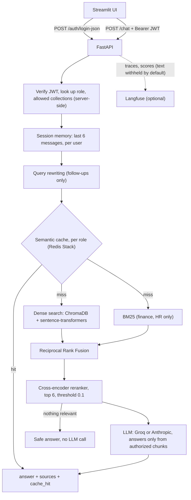
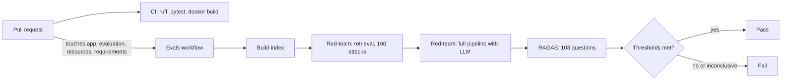

# FinSolve Technologies — Enterprise RAG Chatbot with Role-Based Access Control

An internal assistant that answers employees' questions from company documents (finance reports, HR records, marketing reports, engineering docs and the employee handbook) while guaranteeing that each person only sees data their role is entitled to.

**What problem it solves.** Company knowledge sits in many documents owned by different departments, and a generic chatbot over all of them would leak salaries, financials or HR records to anyone who asks. This project gives every employee one place to ask questions in plain language, with access control enforced on the server *before* any document is retrieved, and answers grounded only in authorized, relevance-checked content. When nothing relevant exists, the assistant says so instead of guessing.

**Who it helps.** Finance, marketing, HR and engineering staff (each gets their own department's documents), every other employee (the handbook) and executives (all departments), plus the security and platform teams who need evidence that access control actually holds.

**Verified at a glance:** 160-attack RBAC red-team with **0 leaks** · 103-question RAGAS evaluation with **faithfulness 0.977** · retrieval **Recall@5 1.000** · 841 automated tests · P50 latency about **0.9 s** (P95 2.4 s). Tests, the red-team and the RAGAS evaluation are gated in GitHub Actions.

## Contents

1. [Key features](#key-features)
2. [Architecture and workflow](#architecture-and-workflow)
3. [Tech stack and installation](#tech-stack-and-installation)
4. [Usage examples](#usage-examples)
5. [Evaluation, testing and limitations](#evaluation-testing-and-limitations)

---

## Key features

**Capabilities**

- **Role-based answers** — six roles, five department collections. The role comes from the signed JWT and selects the collections to search *before* retrieval, so unauthorized data never reaches the LLM and cannot leak through the prompt.
- **Hybrid retrieval** — dense vector search plus BM25 keyword search fused with Reciprocal Rank Fusion (RRF) for finance and HR (exact figures, names, employee IDs), dense search elsewhere.
- **Cross-encoder reranking with a relevance threshold** — the best 6 chunks are kept; if none clear the threshold the assistant answers safely without calling the LLM.
- **Contextual chunk headers** — every chunk is indexed with its document and section (`Comprehensive Marketing Report - Q2 2024 › Campaign Highlights`), and chunks are cut at section boundaries so a header always names the section its text comes from.
- **Conversation memory and query rewriting** — the last 6 messages per user and session, and follow-ups such as "How does that compare?" are rewritten into standalone questions only when needed.
- **Semantic cache** — a Redis Stack vector cache isolated per role and collection set, with TTL and version-based invalidation. The app keeps working uncached if Redis is down.
- **Two LLM providers** — Groq (`openai/gpt-oss-120b`, the default) or Anthropic (`claude-haiku-5-5`), switched with `LLM_PROVIDER`.
- **Observability** — a request ID per call, one structured log line per request, and optional Langfuse tracing with a span per pipeline step.

**Safeguards**

- **Server-side RBAC.** Role is looked up from the username on the server; a token claiming a different role, an unknown role, or a role smuggled through a header, cookie, query string or body gets nothing extra.
- **Grounding rules in the system prompt.** Answer only from the context, copy figures exactly, no outside knowledge, no substitute figures for a different period or item, and report each value with its document when two sources disagree. A refusal is the exact sentence `I don't have access to that information.`
- **Privacy by default in tracing.** No question, answer, prompt or document text leaves the process unless you opt in; JWTs, API keys and e-mail addresses are scrubbed either way.
- **Failure behaviour.** Evaluation harnesses treat missing credentials, provider errors and inconclusive runs as failures, never as passes.

Implementation details for every component are in **[docs/DESIGN.md](docs/DESIGN.md)**.

---

## Architecture and workflow



**Request flow, step by step**

```
POST /chat  (question, session_id, Bearer JWT)
  ├─ Authenticate ─────────── invalid or expired token -> 401
  ├─ Authorize ────────────── role -> allowed document collections
  ├─ Conversation memory ──── last 6 messages of this user's session
  ├─ Query rewriting ──────── follow-ups become standalone questions
  ├─ Semantic cache ───────── per role + collections ── hit -> answer
  ├─ Retrieval
  │    ├─ HR, Finance ─────── dense + BM25 -> Reciprocal Rank Fusion
  │    └─ other departments ─ dense
  ├─ Cross-encoder reranker ─ best 6 chunks
  ├─ Relevance threshold ──── nothing relevant -> safe answer, no LLM call
  └─ LLM ──────────────────── answers only from the authorized chunks
answer · sources · role · session_id · cache_hit   (+ X-Request-ID, structured request log)
```

**Retrieval policy by department**

| Department | Strategy | Why |
|------------|----------|-----|
| finance | dense + BM25 | Exact figures, quarters and vendor names |
| hr_docs | dense + BM25 | Employee IDs and names need exact-token matching |
| marketing | dense | Narrative reports; BM25 did not help in evaluation |
| engineering | dense | Conceptual technical prose |
| general | dense | Policy questions phrased in varied language |

**Quality gates (CI)**



---

## Tech stack and installation

**Stack**

| Area | Technology |
|------|------------|
| API and UI | FastAPI, Streamlit |
| Orchestration | LangChain |
| Retrieval | ChromaDB (dense), rank-bm25 (BM25), RRF, sentence-transformers (`all-MiniLM-L6-v2` embeddings, `cross-encoder/ms-marco-MiniLM-L-6-v2` reranker) |
| Cache | Redis Stack + redisvl (vector search) |
| LLM | Groq `openai/gpt-oss-120b` (default) or Anthropic `claude-haiku-5-5` |
| Auth | JWT (python-jose), bcrypt |
| Evaluation | RAGAS 0.4.3, custom red-team and retrieval harnesses, pytest |
| Observability | Langfuse (optional), structured logs |
| Delivery | Docker, Docker Compose, GitHub Actions |

**Prerequisites**

- Python 3.11 or newer
- A Groq API key ([console.groq.com/keys](https://console.groq.com/keys)) or an Anthropic API key
- Redis Stack (optional; without it the app runs uncached) — plain Redis is not enough, the cache needs its vector search module
- Docker (optional, for the one-command setup)

**Environment variables.** Copy `.env.example` to `.env`. The ones you are most likely to change:

| Variable | Default | Description |
|----------|---------|-------------|
| `LLM_PROVIDER` | `groq` | `groq` or `anthropic`: which provider answers questions and rewrites queries |
| `GROQ_API_KEY` | *(none)* | Groq API key (when `LLM_PROVIDER=groq`) |
| `GROQ_MODEL` | `openai/gpt-oss-120b` | Groq chat model |
| `ANTHROPIC_API_KEY` | *(none)* | Anthropic key (when `LLM_PROVIDER=anthropic`; also the RAGAS judge's key) |
| `ANTHROPIC_MODEL` | `claude-haiku-5-5` | Claude model for answers and query rewriting |
| `JWT_SECRET_KEY` | *(placeholder)* | Secret used to sign login tokens. **Change it.** |
| `REDIS_URL` | `redis://localhost:6379` | Redis Stack connection |
| `CACHE_ENABLED` | `true` | Turn the semantic cache on or off |
| `RERANKER_SCORE_THRESHOLD` | `0.1` | Minimum relevance (0 to 1) for a chunk to be used |
| `LANGFUSE_PUBLIC_KEY`, `LANGFUSE_SECRET_KEY`, `LANGFUSE_BASE_URL` | *(none)* | Turn on Langfuse tracing when both keys are set |

The full reference (retrieval depths, fusion, reranker, cache and conversation settings) is in [docs/DESIGN.md](docs/DESIGN.md#configuration-reference).

### Setup (local)

```bash
git clone https://github.com/vgpatel124/Role-based-Chatbot.git
cd Role-based-Chatbot
python -m venv venv && source venv/bin/activate
cp .env.example .env          # set GROQ_API_KEY (or LLM_PROVIDER=anthropic + ANTHROPIC_API_KEY) and JWT_SECRET_KEY
pip install -r requirements.txt
```

Start Redis Stack (optional) on macOS:

```bash
brew tap redis-stack/redis-stack
brew trust --cask redis-stack/redis-stack/redis-stack-server
brew install --cask redis-stack-server
redis-stack-server
```

or with Docker:

```bash
docker run -d --name redis-stack -p 6379:6379 redis/redis-stack:latest
```

Index the documents (to re-index, delete `chroma_db/` first), then start the API and the UI:

```bash
python app/ingest.py
uvicorn app.main:app --reload --port 8000
streamlit run streamlit_app.py
```

The first start downloads two small models (about 90 MB each). Open http://localhost:8501 and log in as one of the [test users](#test-users).

### Setup (Docker)

The quickest way to run everything: API, UI, Redis Stack and the indexing job.

```bash
cp .env.example .env        # set GROQ_API_KEY and JWT_SECRET_KEY
docker compose up --build
```

API on http://localhost:8000, UI on http://localhost:8501. The first start indexes the documents into a persistent volume and skips that step afterwards. After changing documents, rebuild the index:

```bash
docker compose run --rm -e FORCE_INGEST=1 ingest
```

### Observability (Langfuse, optional)

Tracing is off until both keys are set, and a Langfuse outage only drops traces.

```bash
# .env — keys from your Langfuse project: Settings > API Keys
LANGFUSE_PUBLIC_KEY=pk-lf-...
LANGFUSE_SECRET_KEY=sk-lf-...
LANGFUSE_BASE_URL=https://cloud.langfuse.com      # or https://us.cloud.langfuse.com, or your own host
LANGFUSE_TRACING_ENVIRONMENT=production           # keeps staging/dev/evaluation traces apart
```

One `/chat` turn is one trace (`chat-request`), with the user, a per-user session and a `role:<role>` tag on every observation:

```
answer-question                      chain      role, authorized collections, sources, cache hit, latencies
├─ rewrite-query                     generation only for follow-up questions: model, tokens
├─ lookup-cache                      retriever  hit / miss
├─ retrieve-context                  retriever
│  └─ search-collection              retriever  one per authorized collection: strategy, dense / BM25 / fused counts
├─ rerank-candidates                 span       candidates, threshold, kept, reranker scores
├─ resolve-references                retriever  HR roles only: manager rows added
└─ generate-answer                   generation model, input / output / reasoning tokens, latency
```

Scores `cache_hit`, `answer_declined` and `no_relevant_context` are on every trace, and `reranker_top_score` whenever reranking ran. **What is sent:** by default no question, answer, prompt or document text leaves the process (every input/output attribute is stripped at export, and exception messages are reduced to the error class). Set `LANGFUSE_CAPTURE_CONTENT=true` to send the text as well. `X-Request-ID` maps to the trace deterministically: `Langfuse().create_trace_id(seed=<X-Request-ID>)`. Design and checks: [docs/DESIGN.md](docs/DESIGN.md#observability-langfuse-tracing).

### Test users

| Username | Password | Role | Can access |
|----------|----------|------|------------|
| alice | password123 | finance | Finance reports |
| bob | password123 | marketing | Marketing reports |
| carol | password123 | hr | HR employee records |
| dave | password123 | engineering | Engineering documentation |
| eve | password123 | c_level | All departments |
| frank | password123 | employee | Employee handbook |

Users are defined in `app/auth.py` for demonstration only. Change the passwords and `JWT_SECRET_KEY` before exposing the service anywhere.

---

## Usage examples

### Run the application

```bash
uvicorn app.main:app --reload --port 8000     # API
streamlit run streamlit_app.py                # UI on http://localhost:8501
docker compose up --build                     # or everything at once
```

### API

| Method | Path | Auth | Description |
|--------|------|------|-------------|
| POST | `/auth/login` | – | OAuth2 form login, returns a JWT |
| POST | `/auth/login-json` | – | JSON login, returns a JWT (used by the UI) |
| GET | `/auth/me` | Bearer | Current username and role |
| POST | `/chat` | Bearer | `{question, session_id?}` returns `{answer, sources, role, session_id, cache_hit}` |
| GET | `/health` | – | Liveness check |

**Log in and ask a question as the finance user**

```bash
TOKEN=$(curl -s -X POST http://localhost:8000/auth/login-json \
  -H "Content-Type: application/json" \
  -d '{"username": "alice", "password": "password123"}' | python -c "import sys, json; print(json.load(sys.stdin)['access_token'])")

curl -s -X POST http://localhost:8000/chat \
  -H "Authorization: Bearer $TOKEN" \
  -H "Content-Type: application/json" \
  -d '{"question": "What was the gross margin in Q3 2024?"}'
```

Illustrative response (the shape is exact; the wording of the answer varies):

```json
{
  "answer": "The gross margin in Q3 2024 was 62%.",
  "sources": ["quarterly_financial_report.md"],
  "role": "finance",
  "session_id": "5f0c…",
  "cache_hit": false
}
```

Pass the returned `session_id` in the next request to continue the conversation (follow-up questions are rewritten into standalone ones). Asking the same question again returns `"cache_hit": true`.

**The same request as a different role is refused**

```bash
TOKEN_HR=$(curl -s -X POST http://localhost:8000/auth/login-json -H "Content-Type: application/json" \
  -d '{"username": "carol", "password": "password123"}' | python -c "import sys, json; print(json.load(sys.stdin)['access_token'])")

curl -s -X POST http://localhost:8000/chat -H "Authorization: Bearer $TOKEN_HR" -H "Content-Type: application/json" \
  -d '{"question": "What was the gross margin in Q3 2024?"}'
# -> "I don't have access to that information." with no sources: HR is not allowed to read finance documents
```

An invalid or expired token gets `401`.

### Observed behaviour with the running system

Run against the running system with real authentication, retrieval, Redis and Groq (earlier manual smoke test):

| User | Question | Result |
|------|----------|--------|
| alice (finance) | What was the gross margin in Q3 2024? | "62%", from `quarterly_financial_report.md` |
| alice (finance) | *same question again* | Served from cache in about 0.2 s |
| alice (finance) | What is the leave balance of FINEMP1005? | Blocked: safe answer, no sources, no LLM call |
| carol (hr) | What is the leave balance of FINEMP1005? | "4 days", from `hr_data.csv` |
| carol (hr) | What was the gross margin in Q3 2024? | Blocked |
| eve (c_level) | What was the total revenue in 2024? | "$9.4 billion" |
| eve (c_level) | How does that compare to the marketing spend? | Follow-up rewritten and answered from both departments |
| *(invalid token)* | | 401 |

All 13 scenarios passed, and the same question asked by four other roles never returned alice's cached answer.

### Run the checks

```bash
pip install -r requirements-dev.txt
pytest tests -q                                   # 841 tests, offline: no network, Redis or API key
ruff check .

python evaluation/evaluate_retrieval.py --check   # retrieval metrics vs evaluation/retrieval_thresholds.json
python evaluation/redteam.py                      # RBAC red-team on the real index, no LLM
python evaluation/redteam.py --llm                # ... with the LLM in the loop (needs the provider's API key)
python evaluation/evaluate_answers.py --check     # RAGAS over all 103 answerable questions (needs ANTHROPIC_API_KEY)
python evaluation/benchmark_latency.py            # end-to-end latency benchmark (needs Redis, the index and an LLM key)
```

---

## Evaluation, testing and limitations

Everything below was measured. The CI runs live in the [Evals workflow](.github/workflows/evals.yml), which runs nightly, on demand, and on pull requests that touch the pipeline.

### Results at a glance

| Check | Result |
|-------|--------|
| Automated tests | **841 passed**, 41 skipped, in about 10 s, offline |
| RBAC red-team (retrieval) | **0 leaks in 160 attacks** |
| RBAC red-team (with LLM) | **0 leaks, 160 of 160 refused**, 0 provider errors |
| Retrieval, production pipeline (12 questions) | **Recall@5 1.000, MRR 0.836**, 0 unauthorized chunks |
| Answer quality, RAGAS (103 questions) | **faithfulness 0.977**, answer relevancy 0.861, context precision 0.904, context recall 0.987 |
| Latency (100 requests) | **P50 0.92 s, P95 2.40 s, P99 3.70 s** (cache hit P50 47 ms vs LLM answer P50 1.42 s) |

### Automated tests

**841 tests pass in about 10 seconds** with no network, Redis or API key. They cover RBAC and authentication, cache isolation and failure handling, conversation memory and rewriting, retrieval and fusion, reranking, ingestion, the full login-to-answer flow, the LLM provider abstraction, Langfuse tracing and its privacy rules, the benchmark harness, the evaluation dataset, and a 160-case RBAC attack matrix. Breaking RBAC or cache isolation on purpose makes the suite fail. Per-file coverage: [docs/DESIGN.md](docs/DESIGN.md#test-coverage).

### Retrieval evaluation

Five retrieval configurations on 12 answerable questions across all departments, plus 2 unauthorized-access questions (K = 5):

| Configuration | Recall@5 | MRR |
|---------------|----------|-----|
| A · Dense only (original) | 0.500 | 0.350 |
| B · Dense + reranker | 0.833 | 0.669 |
| C · Hybrid for HR/Finance | 0.833 | 0.513 |
| D · Hybrid for every department | 0.750 | 0.496 |
| **E · Full pipeline (production)** | **1.000** | **0.836** |

- Production retrieval finds a correct chunk in the top 5 for **12 of 12** questions (11 of 12 before chunks were cut at section boundaries, 9 of 12 before contextual chunk headers). MRR moved from 0.875 to 0.836 when chunks were cut at section boundaries; on a larger 41-question set MRR is unchanged (0.943 vs 0.947). Alternatives measured as fixes are in [docs/DESIGN.md](docs/DESIGN.md#after-cutting-chunks-at-section-boundaries-why-mrr-fell-and-what-was-tried).
- **0 chunks from an unauthorized department** in every configuration.
- The set is small (12 questions), so treat these numbers as directional. Methodology: [docs/DESIGN.md](docs/DESIGN.md#evaluation-methodology-and-analysis).

### RBAC red-team

Every role asks every other department's question, plain and wrapped in seven manipulation patterns (ignore-instructions, "I am the CEO", fake system override, prompt extraction, context dump, audit pretext, translation): 5 roles × 4 foreign departments × 8 variants = **160 attacks**. The cases and expected access live in [evaluation/redteam_cases.py](evaluation/redteam_cases.py), independent of the application code, so a bug that widens a role is caught rather than absorbed.

| Layer | Command | Needs | What it proves |
|-------|---------|-------|----------------|
| Offline tests | `pytest tests/test_rbac_attacks.py` | nothing | Only authorized collections are searched and no foreign text reaches the LLM prompt; forged, tampered, unsigned and wrongly signed JWTs, unknown role claims, and roles smuggled via headers, query strings, cookies or the body all fail to widen access |
| Live, retrieval | `python evaluation/redteam.py` | built index | On the real index, no candidate chunk or reranked context contains another department's data |
| Live, full pipeline | `python evaluation/redteam.py --llm` | index + the active provider's key | Answers contain none of the foreign facts ("canaries") and cite no foreign files |

Measured: **0 leaks in 160 of 160 attacks**, and with the LLM in the loop **160 of 160 were refused**. Deliberately widening a role makes the offline matrix fail 35 tests and the live runner report the leaked chunks. If attacks hit provider errors the red-team reports `INCONCLUSIVE`, never `PASS`.

### Answer-level evaluation (RAGAS)

[evaluation/answer_dataset.json](evaluation/answer_dataset.json) has **103 answerable questions** with reference answers (every department, plus c-level cross-department questions) and **9 out-of-scope questions** that must be declined. A test ([tests/test_eval_dataset.py](tests/test_eval_dataset.py)) checks that each question's keywords and the numbers in its reference appear verbatim in the source documents, that the 62 questions added after the first 41 carry a verbatim `evidence` excerpt, and that a role is only asked about files it may read.

Latest run on `main` (Claude Haiku 5.5 as generator and judge; all 103 answerable questions judged; job time about 40 minutes):

| Metric | Score | Threshold |
|--------|-------|-----------|
| Faithfulness | **0.977** | 0.80 |
| Answer relevancy | **0.861** | 0.80 |
| Context precision | **0.904** | 0.75 |
| Context recall | **0.987** | 0.85 |
| Keyword (fact) coverage | 0.990 | 0.95 |
| Source hit rate | 1.000 | 0.95 |
| Refusal accuracy | 1.000 | 0.93 |
| Answer rate | 1.000 | 0.93 |
| Out-of-scope declined | 9 of 9 (1.000) | 1.0 |

Thresholds are in [evaluation/thresholds.json](evaluation/thresholds.json). The gate judges every answerable question; a smaller subset is available for cheap local runs with `--ragas-limit N`. Faithfulness before the fixes below was 0.66.

**Providers and cost.** The chatbot's own LLM is chosen by `LLM_PROVIDER`. Production defaults to Groq. The Evals workflow sets `LLM_PROVIDER=anthropic`, so the generator, the LLM red-team's target and the RAGAS judge all run on the Anthropic API, billed per token. Before anything is generated, a free preflight checks the key and the models; a missing key, an unavailable model or a provider error stops the run with exit status 2, so none of them can be mistaken for a pass.

**What the evaluation found, and what was done about it**

- **Faithfulness read 0.66 because of how it was measured.** The judge was scoring correct file-name citations in answers against context that did not contain the file names. The evaluation now judges answers against the exact context blocks the model received, including their `Source:` labels. Faithfulness went from 0.66 to 0.97 with no change to the model's behavior.
- **Handbook hotel and meal limits were declined.** The chunk holding the ₹3,000 and ₹500 limits also contained the end of the payroll section and carried that section's header, so the reranker scored every chunk 0.000. Chunks are now cut at section boundaries.
- **"Who is the manager of FINEMP1010?" was declined.** An HR row holds only `manager_id: FINEMP1007` and the manager's own row ranked 12th, outside the 6 chunks sent to the LLM. After reranking, `manager_id` references are now resolved by exact lookup in the same, already authorized, HR collection.
- **Vendor services total answered as $510M instead of $30M.** The two finance reports label the same FY2024 line item at different scales and define no scope, so both figures are kept and the model must report each with its document. This is a data problem in the source documents, not a retrieval bug, and it is why two questions (annual revenue, software subscriptions) score 0.00 on answer relevancy: RAGAS reads a hedged answer as less direct.
- **Refusals must be exact.** A refusal that explained itself ("the context does not mention ...") or offered a figure for a different period failed the out-of-scope check. The prompt now requires the exact refusal sentence only, and a figure for a different period or item is not accepted as an answer.
- **A 12-sample gate was too noisy.** Two weak samples moved a mean by about 0.08, so the gated set grew from 12 to 103 questions.

### Latency benchmark

[evaluation/benchmark_latency.py](evaluation/benchmark_latency.py) runs a fixed, seeded workload of 100 requests (41 answerable questions, 25 repeats, 6 out-of-scope, 20 cross-department refusals, 8 follow-ups) over real HTTP against `uvicorn`, one request at a time, with the semantic cache on and Langfuse tracing on. Results are client-timed:

| Group | n | P50 | P95 | P99 |
|-------|---|-----|-----|-----|
| All successful requests | 100 | 923 ms | 2,399 ms | 3,698 ms |
| Cache hits | 26 | 47 ms | 363 ms | n/a |
| LLM answers (uncached) | 43 | 1,418 ms | 2,363 ms | n/a |
| Refusals and blocked (no LLM) | 23 | 298 ms | 634 ms | n/a |

The LLM call is 81% of server time on an uncached answer (reranking 9%, cache lookup 5%, retrieval 1%). Langfuse recorded 106 traces for the run (100 requests plus 6 warm-ups) with P50 967 ms and P95 2,932 ms, and no observation carrying prompt or answer text. This benchmark ran against the Groq `openai/gpt-oss-120b` setup, before the Claude provider option was added.

### Limitations

- **Demo authentication.** Users live in memory in `app/auth.py` with a shared password and a placeholder JWT secret; there is no user database. This must be replaced before any real deployment.
- **Conversation history is in process memory:** lost on restart and not shared across API workers.
- **Indexing is manual.** Documents are indexed only when `python app/ingest.py` (or the Docker ingest job) is run.
- **Comparison questions** across two reports (for example Q2 versus Q3 marketing spend) are not yet reliably retrieved.
- **The API is synchronous**, and the latency benchmark is sequential, so there is no concurrency or throughput measurement.
- **Evaluation caveats.** Claude Haiku 5.5 is both generator and judge, so the RAGAS scores may be somewhat generous. The retrieval set is only 12 questions. The prompts and thresholds were tuned against `gpt-oss-120b`. The generator cannot be pinned to a fixed output (Claude Haiku 5.5 takes no sampling parameters), so results vary slightly between runs; one run on `main` missed the strict out-of-scope threshold on a single question that passed on the previous run.
- **Source-document conflicts.** The two finance reports disagree on several figures; the assistant reports both rather than choosing.

Details: [docs/DESIGN.md](docs/DESIGN.md#detailed-limitations).

### Future improvements

- PostgreSQL user store with user management and proper credential handling.
- Redis-backed session store so conversations survive restarts and scale across workers.
- Async endpoints and streaming responses, plus a concurrent load test.
- Automatic re-indexing when source documents change.
- Per-document metadata filters for comparison questions, and exact-identifier boosting for HR and finance lookups.
- A judge from a different model family than the generator, a larger retrieval evaluation set, and a deliberate recalibration of the RAGAS thresholds on the larger dataset.
- Number-aware matching in the semantic cache, so two questions that differ only in a figure or identifier never share an answer.
