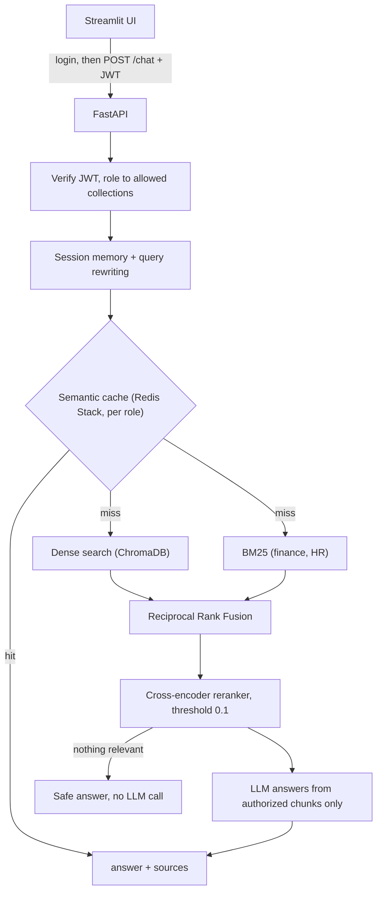

# FinSolve Technologies — Enterprise RAG Chatbot with Role-Based Access Control

An internal assistant that answers employees' questions from company documents (finance, HR, marketing, engineering, handbook) while guaranteeing each person only sees data their role allows. Company knowledge is spread across departments and a generic chatbot would leak salaries or financials; here access is enforced on the server *before* retrieval, and answers come only from authorized, relevance-checked content. If nothing relevant exists, it says so instead of guessing.

**Verified:** 160-attack RBAC red-team with **0 leaks** · RAGAS **faithfulness 0.977** on 103 questions · retrieval **Recall@5 1.000** · 841 tests · P50 latency **0.9 s**, all gated in CI.

## Key features

- **Server-side RBAC:** the role comes from the signed JWT and picks the document collections before any search, so unauthorized data never reaches the LLM.
- **Hybrid retrieval:** dense search plus BM25 fused with Reciprocal Rank Fusion (finance, HR), then cross-encoder reranking with a relevance threshold; no relevant chunk means a safe answer without an LLM call.
- **Conversational:** per-user memory and automatic rewriting of follow-up questions.
- **Fast repeats:** Redis Stack semantic cache, isolated per role.
- **Grounded answers:** answer only from the context, exact figures, refusal is a fixed sentence, conflicting sources are both reported.
- **Two providers and observability:** Groq `openai/gpt-oss-120b` (default) or Anthropic `claude-haiku-5-5`; optional Langfuse tracing that never sends text unless you opt in.

## Architecture



Implementation details: [docs/DESIGN.md](docs/DESIGN.md).

## Tech stack and installation

**Stack:** FastAPI · Streamlit · LangChain · ChromaDB · rank-bm25 · sentence-transformers · Redis Stack · Groq / Anthropic · JWT · RAGAS · Langfuse · Docker · GitHub Actions

**Prerequisites:** Python 3.11+ and a Groq or Anthropic API key. Redis Stack is optional (without it the app runs uncached).

**Key variables** in `.env` (copy `.env.example`; full list in [docs/DESIGN.md](docs/DESIGN.md#configuration-reference)): `LLM_PROVIDER` (`groq` or `anthropic`), `GROQ_API_KEY` or `ANTHROPIC_API_KEY`, `JWT_SECRET_KEY` (**change it**), `REDIS_URL`, and optionally `LANGFUSE_PUBLIC_KEY` / `LANGFUSE_SECRET_KEY` / `LANGFUSE_BASE_URL`.

```bash
git clone https://github.com/vgpatel124/Role-based-Chatbot.git && cd Role-based-Chatbot
python -m venv venv && source venv/bin/activate && pip install -r requirements.txt
cp .env.example .env                                   # add your API key
docker run -d -p 6379:6379 redis/redis-stack:latest    # optional: semantic cache
python app/ingest.py                                   # index the documents
uvicorn app.main:app --port 8000                       # API
streamlit run streamlit_app.py                         # UI on http://localhost:8501
```

Or run everything with Docker: `docker compose up --build`.

**Demo users** (password `password123`): `alice` finance · `bob` marketing · `carol` hr · `dave` engineering · `eve` c_level · `frank` employee.

## Usage examples

```bash
TOKEN=$(curl -s -X POST http://localhost:8000/auth/login-json -H "Content-Type: application/json" \
  -d '{"username": "alice", "password": "password123"}' | python -c "import sys, json; print(json.load(sys.stdin)['access_token'])")

curl -s -X POST http://localhost:8000/chat -H "Authorization: Bearer $TOKEN" -H "Content-Type: application/json" \
  -d '{"question": "What was the gross margin in Q3 2024?"}'
# {"answer": "...", "sources": ["quarterly_financial_report.md"], "role": "finance", "session_id": "...", "cache_hit": false}
```

Endpoints: `POST /auth/login-json`, `GET /auth/me`, `POST /chat` (`{question, session_id?}`), `GET /health`. The same question from `carol` (HR) is refused with no sources.

```bash
pytest tests -q                                  # 841 offline tests
python evaluation/redteam.py --llm               # RBAC red-team (needs the provider key)
python evaluation/evaluate_answers.py --check    # RAGAS over 103 questions (needs ANTHROPIC_API_KEY)
```

## Evaluation, testing and limitations

Measured in the [Evals workflow](.github/workflows/evals.yml) (nightly, on demand, and on pipeline pull requests):

| Check | Result |
|-------|--------|
| Tests | **841 pass**, offline, about 10 s |
| RBAC red-team | **0 leaks in 160 attacks**; 160 of 160 refused with the LLM |
| Retrieval (12 questions) | **Recall@5 1.000, MRR 0.836** (dense-only: 0.500 / 0.350) |
| RAGAS (103 questions) | **faithfulness 0.977** · relevancy 0.861 · precision 0.904 · recall 0.987 |
| Out-of-scope | 9 of 9 declined |
| Latency (100 requests) | **P50 0.92 s, P95 2.40 s**; cache hit 47 ms vs 1.42 s for an LLM answer |

Method, per-metric analysis and findings: [docs/DESIGN.md](docs/DESIGN.md#evaluation-methodology-and-analysis).

**Limitations:** demo-only authentication (in-memory users, placeholder JWT secret); history held in process memory; manual indexing; synchronous API and a sequential latency benchmark (measured on the earlier Groq setup); Claude Haiku 5.5 is both generator and judge, so RAGAS scores may be generous; the retrieval set is only 12 questions; the two finance reports conflict on several figures.

**Future improvements:** PostgreSQL users, Redis-backed sessions, async and streaming endpoints with a load test, auto re-indexing, and a judge from a different model family.
